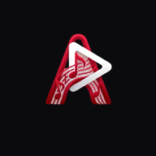
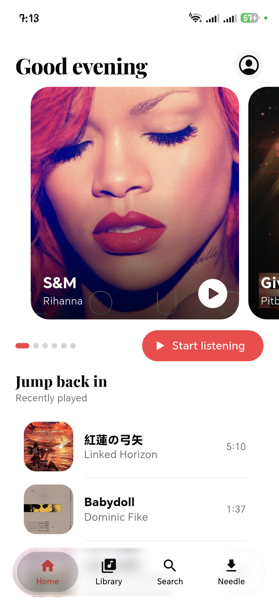
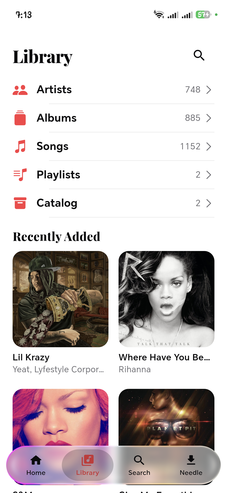
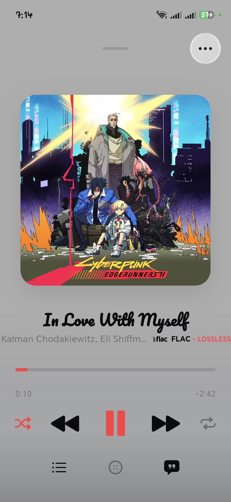
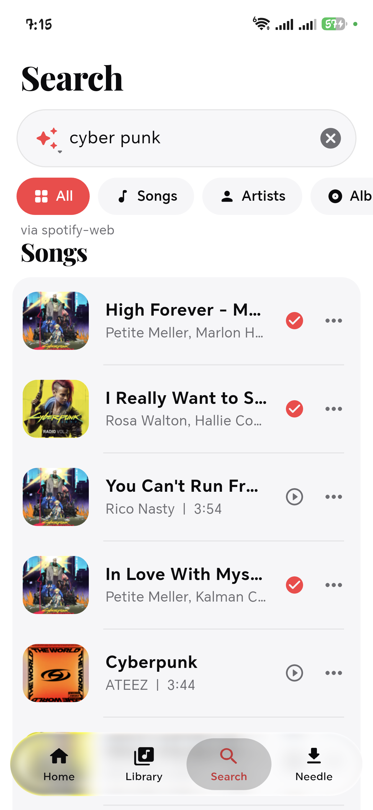
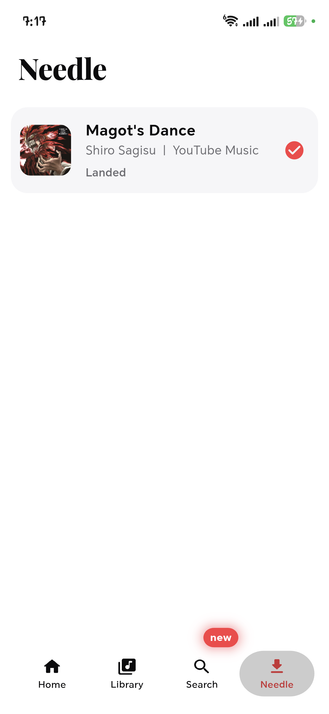
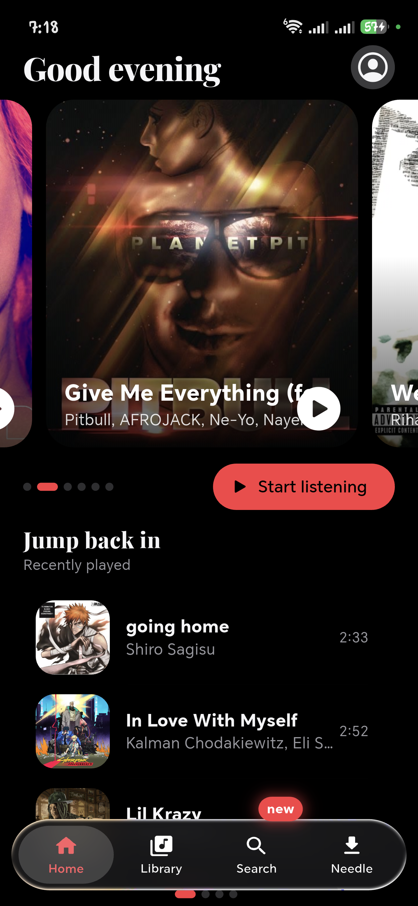

<div align="center">



# Arch Player

**A local-first music player with Needle pulls, with an emphasis on beauty.**

[](LICENSE)
[](https://flutter.dev)
[](https://github.com/Skrol-C/Arch-Player/releases)
[](https://github.com/Skrol-C/Arch-Player/releases/latest)


</div>

## Contents

- [Screenshots](#screenshots)
- [Features](#features)
- [Development](#development)
- [FAQ](#faq)
- [Contributors](#contributors)
- [API credits](#api-credits)
- [Disclaimer](#disclaimer)
- [License](#license)

## Screenshots

| Home | Library |
| ---- | ------- |
|  |  |

| Player | Search |
| ------ | ------ |
|  |  |

| Needle queue | AMOLED |
| ------------ | ------ |
|  |  |

## Features

| | |
|---|---|
| 🎧 **Auto-DJ blends** | Songs hand off to each other, matched by key and tempo. |
| ✨ **Liquid glass** | Pill nav, melting mini player, glass seek thumb. |
| 🌑 **True-black AMOLED** | Pixels off, battery saved, zero burn-in. |
| 🎤 **Synced lyrics** | Word-timed lines, right in the player. |
| 📚 **Local library** | Albums, artists, playlists, tag editing, your files stay yours. |
| 🔌 **Needle pulls** | Grab tracks from your sources, tagged and queued. |

## Development

Arch Player is Flutter + a Rust core (Needle: sandboxed extensions,
audio analysis), with thin Android platform bridges.

Prereqs:

- Flutter 3.47 stable (full path to `flutter/bin`, not on PATH)
- `JAVA_HOME` pointing at Android Studio's bundled JBR
- `ANDROID_HOME` pointing at the local Android SDK
- Rust toolchain with LLVM + Android NDK r28 for the Needle core
  (first build only fetches it; Dart-only changes never touch it)

Run and verify:

```bat
flutter run -d <phone>
dart analyze lib
```

Rules that keep the codebase fast: `dart analyze lib` must be clean
before a push lands, new screens ship on the theme scheme (never
hardcoded paper/ink), glass lives only on floating nav and controls,
and every screen states loading, error, empty, and data.

Native changes (anything under `android/`, plus Rust) need a full
`build apk` and a cold install proof. Hot reload proves nothing there.

## FAQ

<details>
<summary><b>How do I install it?</b></summary>
<br>

Sideload the APK from
[releases](https://github.com/Skrol-C/Arch-Player/releases) and allow
installs from unknown sources when Android asks. That prompt appears
once, at update time, never at startup.
</details>

<details>
<summary><b>Where do Needle files land?</b></summary>
<br>

`Music/Arch Player/Songs/{Artist}/` and `Albums/{Album}/` by default.
Pick any folder (SD cards work) under Settings, Needle, Downloads to
override it; reset returns to the library layout.
</details>

<details>
<summary><b>Do I need an account?</b></summary>
<br>

No. Everything is on device. Providers plug in as sandboxed
extensions you install yourself.
</details>

<details>
<summary><b>How do I get extensions?</b></summary>
<br>

Needle, Repositories, browse the community registry, and install.
Providers plug in as sandboxed extensions you install yourself, and
the priority order decides which one answers first.
</details>

<details>
<summary><b>Fast scrolling smears on true black. Is that a bug?</b></summary>
<br>

That is OLED physics. Pixels waking from full off lag a frame, so fast
scrolls over pure black leave faint trails. It is the panel, not the
app.
</details>

## Contributors

- [Skrol-C](https://github.com/Skrol-C), lead developer and creator

## API credits

- [MusicBrainz](https://musicbrainz.org), canonical releases and artist identity
- [Deezer](https://developers.deezer.com), previews, charts, release data
- [Last.fm](https://www.last.fm), charts and listener counts
- [fanart.tv](https://fanart.tv), artist photos and logos
- [LRCLib](https://lrclib.net), synced lyrics
- [iTunes](https://www.apple.com/itunes/), artwork and lookup fallback
- [GetSongBPM](https://getsongbpm.com), tempo and key lookups

Special thanks to [Mornye](https://github.com/mornyeapp/Mornye) by
[zarzet](https://github.com/zarzet): its extension system, download
API surface, and settings grammar live on in this app. If you like
Arch, check out Mornye first. None of this would have been possible
without it as an open reference.

## Disclaimer

Arch Player is provided as-is, without warranty of any kind. No
copyrighted content is hosted, stored, mirrored, or distributed by
this repository. How you use the download features is your
responsibility: make sure your use complies with applicable law and
the terms of the services you pull from. This project is not
affiliated with, endorsed by, or connected to any streaming service,
label, or other app.

## License

Arch Player is licensed under the **GNU General Public License v3.0**.
See [LICENSE](LICENSE). Copyright (C) 2026 Skrol-C.
